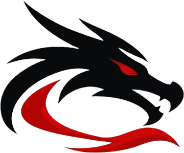

<div align="center">

<picture>
  <source media="(prefers-color-scheme: dark)" srcset="readme_assets/logo/dragongl-plus-dark.png">
  
</picture>

# DragonGL+

**The Long Descent into the Dragon's Maw**

*A 3D dungeon-crawling RPG: 100 floors, 52 races, 12 classes, play solo or with friends.*

[](https://github.com/xvxvxvxvvxvxvvxvxv/dragongl-plus/releases/latest)
[](https://github.com/xvxvxvxvvxvxvvxvxv/dragongl-plus/actions/workflows/ci.yml)
[](LICENSE.txt)


### [⬇️ Windows](https://github.com/xvxvxvxvvxvxvvxvxv/dragongl-plus/releases/latest/download/DragonGL-Plus-windows-x64.zip) &nbsp;·&nbsp; [⬇️ Linux](https://github.com/xvxvxvxvvxvxvvxvxv/dragongl-plus/releases/latest/download/DragonGL-Plus-linux-x86_64.tar.gz) &nbsp;·&nbsp; [📦 All releases](https://github.com/xvxvxvxvvxvxvvxvxv/dragongl-plus/releases)

</div>

---

**DragonGL+** is a fork of [**Dragon GL**](https://github.com/nicolataibi/dragongl) by **Nicola Taibi**.
It runs on Nicola's current server — the whole game world, rule set and fixes of
Dragon GL — and adds a new graphical client, a procedural soundtrack, quality-of-life
features and ready-to-play builds: **download, unzip, double-click — nothing to install.**

## 📑 Contents

- [▶️ Download & play](#️-download--play)
- [✨ What's new in DragonGL+](#-whats-new-in-dragongl)
- [🎮 Controls](#-controls)
- [📜 The game](#-the-game)
- [⌨️ Console commands](#️-console-commands)
- [🖥️ Hosting a server](#️-hosting-a-server)
- [🔨 Building from source](#-building-from-source)
- [🧱 Project layout](#-project-layout)
- [📚 Full manual (Dragon GL)](#-full-manual-dragon-gl)
- [⚖️ Credits & license](#️-credits--license)

---

## ▶️ Download & play

| Platform | Download | How to start |
|---|---|---|
| **Windows 10 / 11** (64-bit) | [**DragonGL-Plus-windows-x64.zip**](https://github.com/xvxvxvxvvxvxvvxvxv/dragongl-plus/releases/latest/download/DragonGL-Plus-windows-x64.zip) | unzip → double-click **`DragonGL-Plus.exe`** |
| **Linux** (x86-64, glibc ≥ 2.27) | [**DragonGL-Plus-linux-x86_64.tar.gz**](https://github.com/xvxvxvxvvxvxvvxvxv/dragongl-plus/releases/latest/download/DragonGL-Plus-linux-x86_64.tar.gz) | extract → double-click **`DragonGL-Plus`** |

> [!TIP]
> All you need is a graphics driver with **OpenGL 3.3** or **Vulkan 1.3** (practically any PC
> from the last ~12 years). Fonts, shaders and the whole soundtrack are inside the
> executable. Linux builds run on Ubuntu 18.04+, Debian 10+, Fedora 28+ and similar;
> `install-desktop-shortcut.sh` adds the game to the applications menu.

**Three ways to play**

- 🧙 **Play Solo** — create a hero and *Begin the Descent*. The game starts a private world
  on your computer; saves live in `%APPDATA%\DragonGL\solo` (Windows) or
  `~/.config/dragongl/solo` (Linux).
- 🤝 **Join a Server** — enter the address, port and server password of a friend's server
  (see [Hosting a server](#️-hosting-a-server)).
- 🏛️ **Dragon GL servers** — servers running Nicola's Dragon GL (protocol v5) are
  recognised automatically and the client switches to a compatibility mode: movement,
  map, combat and chat work as usual; inventory, shops and spells go through
  [chat commands](#️-console-commands) (`inventory`, `use <n>`, `buy <n>`, `cast <spell>`…).
  Creatures appear without names, because those servers do not send them.

Connections are encrypted (TLS 1.3). The first time you join a server its certificate
fingerprint is remembered; if it ever changes, the game refuses to connect and tells you
which line of `known_servers` to remove.

Checksums (`SHA256SUMS.txt`) and older versions are on the
[Releases page](https://github.com/xvxvxvxvvxvxvvxvxv/dragongl-plus/releases).

---

## ✨ What's new in DragonGL+

<table>
<tr>
<td width="50%" valign="top">

### 🎨 Graphics
- One renderer for **OpenGL 3.3** and **Vulkan 1.3**, identical look; Vulkan
  falls back to OpenGL automatically when unavailable.
- Procedural textures (stone, brick, wood, grass, water, lava, crystal…).
- Voxel-style animated models for heroes and every monster family.
- Ambient occlusion, up to 32 dynamic lights, animated water and lava,
  swaying foliage, day/night cycle in the village.
- Fog of war with memory, walls that fade when they hide your hero.
- Particles, flashes, screen shake, floating damage numbers.

</td>
<td width="50%" valign="top">

### 🖱️ Interface
- New menus: title screen over a live dungeon, hero list, character
  creation with a 3D preview, settings, how-to-play, credits.
- HUD with portrait, HP/XP, minimap, objective tracker, hotbar,
  target frame, name plates, toasts and contextual tips.
- Inventory with equipment doll, character sheet, spellbook, shops,
  world map and a full in-game guide (<kbd>F1</kbd>); every window can be
  dragged anywhere and remembers its place.
- Chat with command auto-completion and history.

</td>
</tr>
<tr>
<td valign="top">

### ⚔️ Gameplay & quality of life
- Click to walk (A* pathfinding), attack, talk, pick up; camera-relative WASD.
- Auto-attack, <kbd>Tab</kbd> targeting, <kbd>Space</kbd> attacks the nearest foe.
- **Travel**: right-click an explored spot on the map to walk there.
- Starting gear equipped automatically; creatures move smoothly between your steps.
- Built on Nicola's current server: monsters fight with their bestiary stats,
  resistances and abilities, every spell and magic item works, merchants restock.
- Heroes made with DragonGL+ 2026.10 are imported into the new world automatically.

</td>
<td valign="top">

### 🎵 Audio & builds
- Procedural soundtrack synthesized in real time — six themes with a
  combat layer that swells when enemies are near — plus synthesized SFX.
- Portable Windows and Linux packages, no dependencies (OpenSSL and
  libsodium linked statically).
- The server also runs on Windows; `--local` private mode for Play Solo,
  graceful shutdown that saves everyone.
- CI: Dragon GL's unit and integration tests, sanitizers, a smoke test of
  the Windows server; releases built on every tag.

</td>
</tr>
</table>

---

## 🎮 Controls

All controls are also listed in the game: press <kbd>F1</kbd> or <kbd>H</kbd>.

| Input | Action |
|---|---|
| **Left click** | walk · attack · talk · pick up |
| **Right drag** · <kbd>Q</kbd> <kbd>E</kbd> | rotate the camera |
| **Mouse wheel** · <kbd>Home</kbd> | zoom · reset the camera |
| <kbd>W</kbd><kbd>A</kbd><kbd>S</kbd><kbd>D</kbd> · arrows · numpad | move (relative to the camera) |
| <kbd>Space</kbd> · <kbd>Tab</kbd> | attack the nearest enemy · cycle targets |
| <kbd>F</kbd> · <kbd>G</kbd> | interact (doors, merchants, stairs) · pick up |
| <kbd>I</kbd> <kbd>C</kbd> <kbd>K</kbd> <kbd>M</kbd> <kbd>H</kbd> | inventory · character · spells · map · guide |
| <kbd>1</kbd>–<kbd>4</kbd> · <kbd>5</kbd>–<kbd>0</kbd> | belt potions · spell hotbar |
| <kbd>Enter</kbd> | chat and commands (<kbd>Tab</kbd> completes) |
| <kbd>R</kbd> <kbd>T</kbd> <kbd>L</kbd> <kbd>N</kbd> | rest · search · look · show all names |
| <kbd>Esc</kbd> · <kbd>F12</kbd> | menu · screenshot |
| Drag a title bar · double-click it | move a window · put it back |

---

## 📜 The game

Beneath the ruins of an ancient arcane civilization lies the **Dragon's Maw**, a labyrinth
of **100 floors**. **Floor 0** is the last safe haven: a village with merchants, temples,
dojos, healing fountains and class statues. Every floor below is darker and deadlier.

| Feature | Details |
|---|---|
| 🗺️ **100 procedural floors** | generated with Perlin noise and cellular automata; persistent and shared by every player |
| 👹 **3,900+ monsters** | four difficulty tiers, from goblins and giant rats to ancient dragons and titans |
| 🐉 **Bosses every 10 floors** | a random monster of the tier becomes the guardian; only those who defeat it may go deeper |
| 🛒 **Wandering merchants** | on every 5th floor, with scaling equipment and rare elixirs |
| 🎲 **d20 rule set** | polyhedral dice, advantage/disadvantage, AC, proficiency, saving throws, levels 1–20 |
| 🧪 **Survival** | hunger and exhaustion, 15+ status conditions, resistances and vulnerabilities, NPC morale |
| ⚠️ **Traps, mining, economy** | disarm or salvage traps, dig gold and silver veins, haggle with a reactive market |
| 🪦 **Death matters** | fallen heroes leave a tombstone with their gear |

<details>
<summary><b>🧬 52 playable races</b></summary>
<br>

Human · Elf · Dwarf · Gnome · Giant-kin · Halfling · Orc · Fiend-blood · Celestial-blood ·
Dragon-kin · Half-Elf · Half-Orc · Feline-folk · Avian-folk · Raven-folk · Turtle-folk ·
Goblin · Hobgoblin · Bugbear · Kobold · Minotaur · Centaur · Serpent-folk · Elemental-kin ·
Sea-folk · Forest-giant · Astral-strider · Shapeshifter · Sprite · Iron-forged ·
Elephant-folk · Logic-kin · Slime-kin · Insect-folk · Clockwork-kin · Lion-folk · Faun ·
Rabbit-folk · Owl-folk · Frog-folk · Fish-folk · Skin-changer · Dream-touched · Bio-mutant ·
Chaos-born · Hippo-folk · Simian-glider · Void-elf · Trickster-kin · Half-vampire ·
Witch-blood · Awakened-dead

Each race has its own traits and a dedicated 3D model.
Portraits and descriptions: [Dragon GL manual → Races](https://github.com/nicolataibi/dragongl/blob/main/LORE.md#-playable-ancestries-races).

</details>

<details>
<summary><b>🛡️ 12 classes</b></summary>
<br>

| Class | Hit die | Key ability | | Class | Hit die | Key ability |
|---|:-:|---|---|---|:-:|---|
| Barbarian | d12 | Strength | | Paladin | d10 | Strength, Charisma |
| Bard | d8 | Charisma | | Ranger | d10 | Dexterity, Wisdom |
| Cleric | d8 | Wisdom | | Rogue | d8 | Dexterity |
| Druid | d8 | Wisdom | | Sorcerer | d6 | Charisma |
| Fighter | d10 | Strength or Dexterity | | Warlock | d8 | Charisma |
| Monk | d8 | Dexterity, Wisdom | | Wizard | d6 | Intelligence |

Every class has a temple or dojo on Floor 0 where its spells and techniques are learned.
Portraits: [Dragon GL manual → Classes](https://github.com/nicolataibi/dragongl/blob/main/LORE.md#️-heroic-professions-classes).

</details>

---

## ⌨️ Console commands

Most actions have a button or a key, but everything is also available as a text command:
press <kbd>Enter</kbd>, type, and use <kbd>Tab</kbd> to complete.

<details>
<summary><b>⚔️ Items & character</b></summary>
<br>

| Command | Aliases | What it does |
|---|---|---|
| `inventory` | `i` | backpack, belt and equipment |
| `wield <n>` | `w` `wear` `equip` | equip a weapon, armour, ring or amulet |
| `takeoff <slot>` | `remove` `unequip` | unequip an item |
| `belt <n>` / `unbelt <n>` | | move an item to / from the quick belt |
| `use <n>` | `q` `quaff` `eat` `zap` `z` | drink, eat or activate an item (`eat` alone eats a ration) |
| `read <n>` | `r` | read a scroll |
| `lore <n>` | | read an item's description or a book's index |
| `get [dir]` | `g` | pick up items |
| `drop <n>` / `throw <n> <dir>` | `d` / `v` | drop or throw an item |
| `fill <lantern>` | | refill a lantern with oil |
| `status` | `stats` | full character sheet |
| `train <stat>` | | spend stat points gained on level-up (`train random`) |

</details>

<details>
<summary><b>🗺️ World</b></summary>
<br>

| Command | Aliases | What it does |
|---|---|---|
| `look` | `l` | describe the eight surrounding directions |
| `search` | `s` | look for hidden traps |
| `examine` | `ex` | find ore veins around you |
| `tunnel <dir>` | `T` | dig through rock (`tunnel d` digs down) |
| `open <dir>` / `close <dir>` | `o` / `c` | doors |
| `disarm [salvage\|magic]` | `D` | disarm a trap, salvage its parts or dispel it with magic |
| `rest` | `R` | recover HP and spell slots in the village |
| `pray` | `p` | ask the gods for help (restores 25% HP) |
| `fountain` · `statue` | | heal at a fountain · meditate at your class statue (Floor 0) |

</details>

<details>
<summary><b>🏪 Merchants & temples</b></summary>
<br>

| Command | What it does |
|---|---|
| `talk` | speak with the merchant next to you |
| `list` · `browse <n>` | show the stock · inspect an item |
| `buy <n>` · `sell <n>` | trade |
| `haggle buy\|sell` | negotiate with Charisma |
| `identify <n>` · `repair <n>` | identify (100 gp) · repair items |
| `cure` · `uncurse` | remove poison and disease · remove curses |

</details>

<details>
<summary><b>🔮 Magic & 💬 chat</b></summary>
<br>

| Command | What it does |
|---|---|
| `spells` | list your known spells |
| `study <n>` | learn a spell at your temple (class rituals: `pray`, `awaken`, `invoke`, `intone`, `celebrate`, `pronounce`, `practice`) |
| `cast <spell>` | cast a spell |
| `say <text>` | talk to nearby players (`shout`) |
| `msg <name> <text>` | private message (`tell`, `whisper`) |
| `who` | players online and their floor |
| `block <name>` · `unblock <name>` · `blocks` | manage your block list |

</details>

The complete reference, with every option and edge case, is in the
[Dragon GL manual → Player Console Commands](https://github.com/nicolataibi/dragongl/blob/main/LORE.md#️-player-console-commands).

---

## 🖥️ Hosting a server

Both packages include the dedicated server (it is Nicola's server, with the DragonGL+
extension). Put the access password in a text file, then on the host computer:

```sh
# Windows
dragongl_server.exe -P 8080 --password-file server-password.txt
# Linux
./dragongl_server -P 8080 --password-file server-password.txt
```

Open **TCP port 8080** on the firewall/router; players choose **Join a Server** and enter
the address, port and server password. Passwords are never accepted on the command line;
the server creates its TLS certificate at the first start and logs its fingerprint, which
players can compare with the one their game shows.

| Option | Meaning | Default |
|---|---|---|
| `-P`, `--port` | TCP port | `8080` |
| `--password-file <f>` | password every player needs to join (8–63 characters) | `DRAGONGL_SERVER_PASSWORD` variable |
| `--dm-password-file <f>` | password of the Dungeon Master account (`dm`) | none: no DM account |
| `-D`, `--data-dir` | game data (bestiary, items, spells) | `data/` next to the program |
| `-S`, `--state-dir` | where the world, characters and certificate are saved | `~/.local/state/dragongl`, `%LOCALAPPDATA%\DragonGL\server` |
| `--tls-cert`, `--tls-key` | a certificate of your own | created at the first start |

Both DragonGL+ players and Dragon GL players (Nicola's client) can join a DragonGL+ server.

<details>
<summary><b>👑 Dungeon Master commands</b></summary>
<br>

Log in with the name **`dm`** and the DM password to get these commands:
`dm_telemetry`, `dm_gold`, `dm_level`, `dm_spawn`, `dm_boss`, `dm_merchant`, `dm_place`,
`dm_shop`, `dm_goto`, `dm_find_monster`, `dm_find_item`, `dm_mapfloor`, `dm_pdf`.

Details: [Dragon GL manual → Dungeon Master privileges](https://github.com/nicolataibi/dragongl/blob/main/LORE.md#-dungeon-master-dm-privileges).

</details>

<details>
<summary><b>🛠️ Client command line & environment</b></summary>
<br>

```sh
DragonGL-Plus [gl|vk] [--fullscreen|--windowed] [server_ip [port]]
```

- `gl` / `vk` force OpenGL or Vulkan (also selectable in *Settings → Graphics*).
- A server address pre-fills the *Join a Server* form.
- `DRAGONGL_NO_VULKAN=1` disables Vulkan, `DRAGONGL_VK_VALIDATION=1` enables the validation layers.
- Settings are stored in `%APPDATA%\DragonGL\settings.ini` or `~/.config/dragongl/settings.ini`.

</details>

---

## 🔨 Building from source

The client libraries are vendored in `third_party/` (GLFW, volk, Vulkan headers,
miniaudio, stb, wepoll, cJSON, fonts); the server and the encrypted connection need
OpenSSL 3 and libsodium.

```sh
# Linux  (Debian/Ubuntu: sudo apt install build-essential cmake libssl-dev libsodium-dev \
#                        libx11-dev libxrandr-dev libxinerama-dev libxcursor-dev libxi-dev)
cmake -B build -DCMAKE_BUILD_TYPE=Release
cmake --build build -j
./build/dragongl_client            # or: ./build/dragongl_client vk

# Tests: Dragon GL's unit and integration suites plus the DragonGL+ extension
cmake -B build-tests tests && cmake --build build-tests && ctest --test-dir build-tests
cmake -B build-it tests/integration && cmake --build build-it && ctest --test-dir build-it -j4

# Windows, cross-compiled from Linux with MinGW-w64 (static OpenSSL/libsodium first)
tools/build_deps.sh windows deps-win
cmake -B build-win -DCMAKE_TOOLCHAIN_FILE=cmake/toolchain-mingw64.cmake -DDRAGONGL_PORTABLE=ON \
      -DDRAGONGL_DEPS_PREFIX=$PWD/deps-win
cmake --build build-win -j

# Portable release archives for both platforms, into dist/
tools/build_release.sh
```

- **Windows, natively:** MSYS2 with `mingw-w64-x86_64-gcc`, `cmake` and `ninja` works with the same commands.
- **Shaders:** recompiled when `glslc` is installed, otherwise the pre-built SPIR-V in `shaders/spv/` is used.
- **Fedora / RHEL:** an RPM can be built with `dragongl.spec`.
- **Releases:** pushing a tag such as `v2026.11` makes GitHub Actions build both packages
  and attach them, with `SHA256SUMS.txt`, to the release of that tag.

---

## 🧱 Project layout

| Path | Contents |
|---|---|
| `src/client/` | game client: menus and HUD, scene builder, OpenGL and Vulkan back-ends, audio and music |
| `src/server/` | Dragon GL's authoritative server; `server_plus.c` is the DragonGL+ extension |
| `src/shared/` | network protocol (`wire.c`, `wire_plus.c`), TLS, map generation, rules, data loading, Windows layer |
| `tests/` | unit and integration tests (Dragon GL's and DragonGL+'s) |
| `data/` | bestiary, items and spells (JSON) |
| `shaders/` | GLSL sources and pre-built SPIR-V |
| `tools/` | release scripts, balance analyser, PDF map generator, web data editors |
| `man/` | manual pages |

---

## 📚 Full manual (Dragon GL)

Nicola Taibi's `LORE.md` is the complete manual of the game world and its rules, with
hundreds of illustrations. To keep this page light, those sections are not repeated
here — they apply to DragonGL+ and can be read in the original repository. The network
protocol is in [PROTOCOL.md](PROTOCOL.md), the DragonGL+ extension in
[PROTOCOL_PLUS.md](PROTOCOL_PLUS.md).

| Topic | Sections |
|---|---|
| 🌍 **World & story** | [The Lore](https://github.com/nicolataibi/dragongl/blob/main/LORE.md#-the-lore-the-deep-descent) · [The Legend of Kaelen](https://github.com/nicolataibi/dragongl/blob/main/LORE.md#-the-legend-of-kaelen-expansion-of-the-descent) · [Dragon's Maw — the novel (10 books)](https://github.com/nicolataibi/dragongl/blob/main/LORE.md#dragons-maw) |
| 🧑‍🤝‍🧑 **Heroes** | [Races, with portraits](https://github.com/nicolataibi/dragongl/blob/main/LORE.md#-playable-ancestries-races) · [Classes](https://github.com/nicolataibi/dragongl/blob/main/LORE.md#️-heroic-professions-classes) · [Conditions, hunger & combat](https://github.com/nicolataibi/dragongl/blob/main/LORE.md#-advanced-mechanics-conditions-hunger--combat) |
| 🏰 **Dungeon** | [Trap gallery](https://github.com/nicolataibi/dragongl/blob/main/LORE.md#️-trap-gallery) · [Thematic rooms](https://github.com/nicolataibi/dragongl/blob/main/LORE.md#-procedural-thematic-rooms) · [Monsters & bosses](https://github.com/nicolataibi/dragongl/blob/main/LORE.md#-monster--boss-generation-system-difficulty-tiers) · [Voxel types](https://github.com/nicolataibi/dragongl/blob/main/LORE.md#-voxel-type-reference-technical-appendix) · [Map dump](https://github.com/nicolataibi/dragongl/blob/main/LORE.md#maps-dump) |
| 🏙️ **Village** | [City (Floor 0)](https://github.com/nicolataibi/dragongl/blob/main/LORE.md#️-city-floor-0-and-ui-updates) · [Temples and dojos](https://github.com/nicolataibi/dragongl/blob/main/LORE.md#temples-and-dojos) · [Statues](https://github.com/nicolataibi/dragongl/blob/main/LORE.md#statues) · [Fountains](https://github.com/nicolataibi/dragongl/blob/main/LORE.md#fountains) |
| 💰 **Economy & loot** | [Merchant guild](https://github.com/nicolataibi/dragongl/blob/main/LORE.md#️-economy--merchant-guild) · [Loot, rarity & grimoires](https://github.com/nicolataibi/dragongl/blob/main/LORE.md#-economy-loot--rarity-system) · [Reactive economy](https://github.com/nicolataibi/dragongl/blob/main/LORE.md#-reactive-economy-supply-demand-system) |
| 🔮 **Magic** | [Magic propagation & AoE](https://github.com/nicolataibi/dragongl/blob/main/LORE.md#️-magic-propagation-area-of-effect-aoe--vfx-types) · [Spell effects and magic router](https://github.com/nicolataibi/dragongl/blob/main/LORE.md#-spell-effects-and-the-magic-router) |
| ⚙️ **Engine internals** | [Core architecture](https://github.com/nicolataibi/dragongl/blob/main/LORE.md#️-core-architecture--features) · [Save state](https://github.com/nicolataibi/dragongl/blob/main/LORE.md#-complete-save-state--voxel-persistence) · [Speed/tick system](https://github.com/nicolataibi/dragongl/blob/main/LORE.md#-advanced-speedtick-system) · [Swarm AI](https://github.com/nicolataibi/dragongl/blob/main/LORE.md#-swarm-ai-umoria-inspired-modernized) · [FloorStats cache](https://github.com/nicolataibi/dragongl/blob/main/LORE.md#-performance-optimization-floorstats-cache) |
| 🖼️ **Original release** | [Screenshots](https://github.com/nicolataibi/dragongl/blob/main/LORE.md#screenshots) · [Original Vulkan renderer](https://github.com/nicolataibi/dragongl/blob/main/LORE.md#-vulkan-gpu-driven-rendering-architecture) |

> [!NOTE]
> The original screenshots and the description of the original HUD show the 2026 Dragon GL
> client; DragonGL+ replaces that client, while the world, rules and content are the same.

---

## ⚖️ Credits & license

- **Dragon GL** — © 2026 [Nicola Taibi](https://github.com/nicolataibi/dragongl), GPL-3.0-or-later.
  The original illustrations ([`readme_assets/`](https://github.com/nicolataibi/dragongl/tree/main/readme_assets)
  in Nicola's repository) are released under
  [CC BY 4.0](https://creativecommons.org/licenses/by/4.0/): *"This collection features
  AI-generated assets, curated and prompted by Nicola Taibi, generated by Gemini (Google AI),
  ChatGPT."*
- **DragonGL+** — fork distributed under the same license, [GPL-3.0-or-later](LICENSE.txt).
- **Third-party components** — GLFW (zlib), volk (MIT), Vulkan headers (Apache-2.0 / MIT),
  miniaudio (MIT-0), stb (public domain / MIT), wepoll (BSD-2), cJSON (MIT), OpenSSL
  (Apache-2.0), libsodium (ISC), Cinzel and Alegreya Sans fonts (SIL OFL 1.1); the Windows build also contains the
  MinGW-w64 runtime and winpthreads (ZPL-2.1 / MIT / BSD). Their licenses ship in the
  `licenses/` folder of every package.
- DragonGL+ is provided **without any warranty**, as stated in the GPL.

<div align="center">
<br>

**[⬆ Back to top](#dragongl)**

</div>
